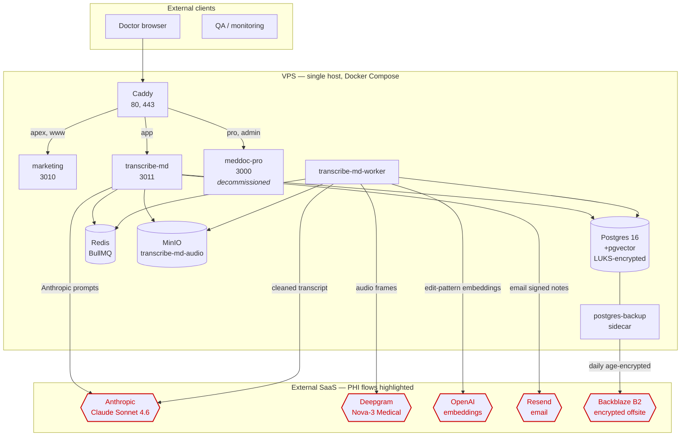

# Issue

`README.md` §"Architecture at a glance" describes the stack textually (Next.js / Postgres+pgvector / Redis+BullMQ / MinIO / Anthropic+Deepgram+OpenAI / Resend / Caddy / Sentry). There is no architecture diagram — Mermaid or external — anywhere in the repository. A diagram is a faster comprehension path than 11 bullets of prose, and it makes implicit relationships explicit (which services consume which env, which external SaaS sees PHI, which container exposes which port to which network).

# Evidence

```
$ find /opt/meddoc-pro -type f \( -name "*.mmd" -o -name "*.puml" -o -name "*.drawio" -o -name "*.excalidraw" \) -not -path "*/node_modules/*"
(no results)
$ grep -rE '^\s*```mermaid' /opt/meddoc-pro --include="*.md" --exclude-dir=node_modules | head
(no results)
$ find /opt/meddoc-pro/docs -type f \( -name "*.png" -o -name "*.svg" \) -not -path "*/screenshots/*" -not -path "*/playwright-report*"
(no results)
```

`README.md:11-26` is text-only. The clearest existing topology summary is in `LAUNCH_READINESS.md:23-33` — a 9-row table of containers + UID + status. Useful, but doesn't show the connection graph or the external boundaries.

The closest things to architecture documentation in the repo:

- `apps/transcribe-md/WORKER.md` — pipeline diagram (TRANSCRIBING → EXTRACTING → DRAFTING → CRITIQUING → POLISHING → READY) for the worker layers, but only the worker side; no broader topology.
- `docs/POST_MERGE_TODO.md` Phase 5.2 prose describes the Coding Coach Path C (deterministic + LLM-judge); not a diagram.
- `docs/PROTECTED_CONTRACTS.md` — 62 API routes in tables; no diagram.

The full topology that an architecture diagram should show:

```
External clients
    │
    ▼
Caddy (port 80, 443) ────► Let's Encrypt ACME
    │
    ├── apex / www ────► marketing (3010)
    ├── app          ────► transcribe-md (3011)
    └── pro / admin  ────► meddoc-pro (3000) [decommissioned]
                                │
                                ▼
                Postgres (5432, /mnt/pgdata-encrypted on LUKS)
                Redis (6379)
                MinIO (9000 API, 9001 console)

transcribe-md-worker ──► BullMQ (Redis)
                     ──► Postgres
                     ──► MinIO (transcribe-md-audio bucket)
                     ──► Anthropic api.anthropic.com  [PHI: cleaned transcript text]
                     ──► Deepgram api.deepgram.com    [PHI: audio frames + transcripts]
                     ──► OpenAI api.openai.com         [PHI: embedded text snippets]

postgres-backup sidecar ──► local /backups/last/
                          ──► Backblaze B2 (PHI: encrypted blobs)

transcribe-md ──► Resend api.resend.com  [PHI: signed-note delivery]
              ──► Anthropic (T-M21 SOAP citations + Coding Coach)
```

The diagram should mark each PHI-touching boundary so that the BAA list (see A12-P0-001) is visually anchored.

# Risk

- **Onboarding**: per A12-P1-003, an onboardee needs to absorb the topology in <2 hours. A diagram does this in 60 seconds; prose takes 15 minutes and leaves gaps.
- **Compliance review**: every Security Rule auditor asks for a data-flow diagram showing PHI boundaries. Producing one ad-hoc under audit is fine but is also a tell that the program is reactive.
- **Threat model anchoring**: the threat model (per A12-P1-004) should be anchored on a diagram — each asset class on the diagram has a STRIDE row in the threat model.
- **Incident response**: when a container goes unhealthy, knowing its upstream + downstream dependencies in 5 seconds lets the operator isolate vs cascade decisions in seconds, not minutes.

# Recommended fix

Add a Mermaid diagram to `README.md` §"Architecture at a glance". Mermaid is supported on GitHub and renders inline. Skeleton:



The diagram should be the **single source of truth** for the topology — both `LAUNCH_READINESS.md` §A and the future `ONBOARDING.md` should reference it rather than duplicating. Update on every Phase that adds/removes a service or external dependency.

Optional: a sequence diagram for the visit-pipeline flow (audio upload → MinIO → BullMQ → Deepgram → Anthropic 6/7 layers → Postgres) in `apps/transcribe-md/WORKER.md`. Mermaid `sequenceDiagram` works well for this. The current text version (the table at WORKER.md:14-25) is OK; a sequence diagram would make the layer dependencies + retry behaviour visual.

For the threat model + ADR work in A12-P1-004, the diagram becomes load-bearing for both — every PHI-touching arrow in the diagram is a STRIDE row in the threat model + a candidate ADR.
