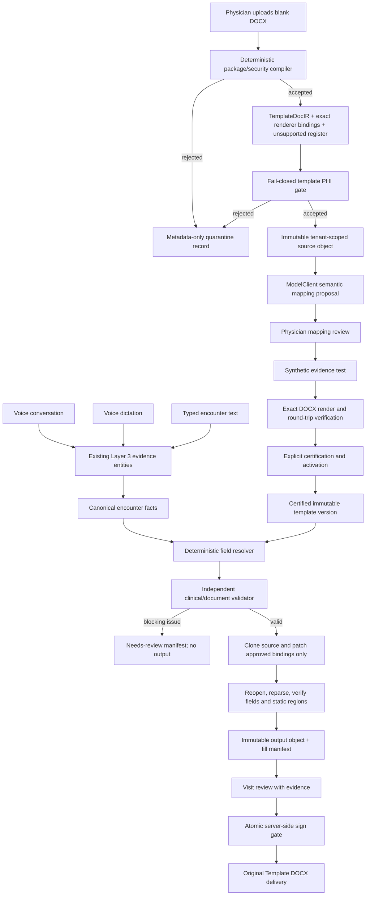

# Template Twin — Structure-Preserving DOCX v1

## Status and safety invariant

**Repository status:** implemented on `feat/template-twin-docx-v1`; not deployed to production. This document is an architecture and operations handoff, not deployment approval.

Template Twin adds an exact-source Word delivery alongside the existing SOAP, coding, PDF, generic DOCX, email, and clipboard flows. It does not replace those flows.

The clinical invariant is:

> A clinical value may be rendered into the physician's DOCX only when it resolves from retained encounter evidence or an explicitly approved practice default, passes independent validation, and survives exact-binding round-trip verification. Otherwise it stays blank and/or blocks signing according to its certified policy.

No production migration, bucket provisioning, image build, service restart, or deployment was performed as part of this branch.

## Architecture and data flow



The implementation is divided into these boundaries:

| Boundary | Primary code | Responsibility |
| --- | --- | --- |
| Untrusted DOCX | `apps/transcribe-md/src/lib/note-template-docx/` | ZIP/OPC/XML validation, deterministic compilation, rendering, and round-trip proof |
| Shared contracts | `apps/transcribe-md/src/lib/template-twin/ir.ts` | Provider-neutral IR, facts, mappings, resolutions, validation, and manifest schemas |
| Artifact custody | `apps/transcribe-md/src/lib/template-twin/storage/` | Tenant-scoped keys, immutable-style writes, metadata/hash verification, and bounded reads |
| Draft and certification | `create-draft.ts`, `certification-lifecycle.ts`, `synthetic-test.ts` | Persist draft, propose/approve mappings, synthetic proof, certify, and activate |
| Encounter filling | `encounter-facts/`, `resolver/`, `validation/`, `fill-engine.ts` | One voice/text fact path, exact field resolution, validation, rendering, and manifest persistence |
| Review and signing | `components/visit/template-twin-review*`, `review-service.ts`, `signing-gate.ts`, visit sign route | Minimal review DTO, labeled physician corrections, explicit mapping-version forks, server-side signing enforcement, and immutable sign decision |
| Delivery | `export/original-template-docx/route.ts` | Authenticated read of the already-rendered, hash-verified output; never regenerates at download time |

Version constants in v1 are:

- IR schema: `1`
- compiler: `template-docx-compiler/1.0.0`
- resolver: `template-field-resolver/1.0.0`
- renderer: `template-docx-renderer/1.0.0`
- validator: `template-field-validator/1.0.0`

## Immutable artifacts and tenant boundary

The source DOCX is stored before database activation under an opaque key shaped like:

```text
practices/<practice-id>/template-twin/sources/<lineage-id>/v<version>/<opaque-id>/<sha256>.docx
```

Rendered outputs use:

```text
practices/<practice-id>/template-twin/outputs/<visit-id>/<manifest-sha256>/<opaque-id>/<output-sha256>.docx
```

The application:

- never uses a user filename as an object key;
- validates the key grammar and practice prefix before every read;
- verifies provider metadata, byte length, and SHA-256 before accepting a source or output;
- reads with a hard size ceiling and hashes the stream as it is consumed;
- has no Template Twin delete or overwrite method;
- stores source and output object keys only in server-side database rows;
- never sends object keys, hashes, or storage credentials to the browser review DTO;
- does not log document bytes, extracted document text, transcript text, field values, or evidence quotes in operational/audit metadata.

Database triggers make source-artifact rows and certification rows append-only. Certified compiler/field/mapping rows cannot be changed or deleted. Once `signedDecisionAt` is set, the fill-manifest row cannot be changed or deleted.

This is application and database immutability. Storage administrators remain a privileged threat unless the bucket is also protected with object lock/versioning and restrictive IAM; see [Private bucket provisioning](#private-bucket-provisioning-required-before-runtime-use).

## Untrusted-document defenses

Every uploaded file is treated as an untrusted ZIP/OOXML package. The upload route first enforces same-origin mutation, authenticated physician ownership, `.docx` extension, allowed MIME, non-empty bytes, and a 10 MiB source limit. The compiler then performs its own byte-level checks and does not trust the filename or browser MIME.

Default compiler limits include 512 entries, 16 MiB per expanded entry, 64 MiB total expanded content, a 100:1 maximum compression ratio, 12 MiB per parsed XML part, XML depth 128, 2,000 fields, 500 tables, and 10,000 structural nodes. Artifact reads/writes have a separate 25 MiB ceiling; source uploads remain subject to the stricter 10 MiB limit.

Rejected package classes include:

- wrong ZIP magic, missing/invalid central directory, CRC or size mismatch, overlapping local entries, or corrupt OPC declarations;
- ZIP64, multi-disk ZIP, encrypted entries, symbolic links, duplicate/case-colliding paths, unsupported compression methods, path traversal, and unsafe encoded paths;
- source, entry, total expansion, entry-count, compression-ratio, XML-depth, and structure-limit violations;
- macro-enabled DOCM content, VBA, ActiveX, custom UI, digital-signature active parts, OLE/package embeddings, `altChunk`, DDE/DDEAUTO, linked database/include fields, and attached templates;
- external or remote relationships, including `TargetMode="External"`;
- DTD/entity declarations and malformed XML;
- missing or inconsistent `word/document.xml`, content types, relationships, headers, or footers.

Rejected bytes are not stored. A metadata-only quarantine row may retain the digest, size, tenant/uploader, and a safe rejection code. Quarantine failures do not make an unsafe document acceptable.

Before source storage, visible text from document, header, footer, footnote, endnote, and comment parts passes the existing deterministic PHI detector and a fail-closed privacy scan through the shared `modelClient`. The scan sends the visible part text to the configured Anthropic clinical model; therefore the appropriate vendor agreement, approved data handling, and zero/limited-retention configuration are prerequisites. Provider failure, uncertainty, over-limit text, suspected prompt injection, or possible patient-specific content rejects the upload. A reusable template containing real patient information must never be accepted.

## Deterministic compiler and `TemplateDocIR`

The compiler reads OOXML structure directly; it does not ask a language model to rediscover Word controls. It inventories the main document, headers, footers, relationships, styles, numbering, media, static nodes, bookmarks, and tables.

Supported/detected v1 structures include:

- plain and rich text content controls;
- native dropdowns with exact option order and stored value/display text;
- combo boxes, dates, and native Word checkboxes;
- safely detectable legacy text, dropdown, date, and checkbox form fields;
- fixed tables and table-cell bindings;
- table-backed repeating sections/rows, capped at 100 rows;
- table grids, horizontal `gridSpan`, vertical `vMerge`, nested-table counts, fixed rows, headers, footers, bookmarks, tags, aliases, Word IDs, and legacy names;
- static content hashes for every relevant part and exact structural paths for renderer bindings.

Stable `fieldId`, `tableId`, and node IDs are derived from deterministic structure and hashes, not labels alone. Duplicate labels therefore remain distinct. Each fillable field records its exact part, structural path, binding kind, ordinal, original content hash, source-control hash, table location, and native identifiers.

Unsupported or ambiguous structures are appended to the IR with a safe code, part, path, clinical-materiality flag, and `blocksCertification` decision. Examples include data-bound controls, ambiguous/duplicate select options, non-table repeating sections, row-container ambiguity, dynamic fields, malformed controls, and imported alternative-format content. Clinically material or certification-blocking entries prevent activation; they are never silently discarded.

The IR separately hashes:

- the immutable source package;
- the extracted structure (fields, tables, nodes, unsupported register);
- static content by part; and
- each binding's source control and original content.

## Semantic mapping and certification lifecycle

After deterministic compilation, the shared `modelClient` may propose semantic metadata for the compiler-defined field set. The structured output can propose concept, data type, polarity, temporality, laterality, unit policy, synonyms, requiredness, and blank/unknown policy. It cannot create/delete fields, move controls, alter the layout, reorder/change native options, invent practice defaults, or activate a template.

If the mapping provider is unavailable, deterministic fallback mappings are saved as visibly unconfirmed. They cannot be certified without physician review.

The certification flow is:

1. Upload a blank source DOCX.
2. Compile the package through all structural/security gates and build the IR/unsupported register.
3. Run the fail-closed template PHI gate, then store the accepted immutable source.
4. Review totals, controls, tables, every field, allowed options, semantic mapping, requiredness, and unknown policy.
5. Save physician mapping corrections. Saving invalidates any previous synthetic proof.
6. Enter explicitly marked synthetic encounter text or record explicitly marked synthetic dictation and run the same Layer 3 fact/resolver/validator/renderer pipeline in uncertified-test mode. Before Layer 3 or persistence, the input must pass deterministic structured-PHI rejection and the conservative shared `modelClient` privacy gate. Synthetic audio is sent through the existing Deepgram orchestrator without cross-provider fallback and is never stored by QuillMD.
7. Download and inspect the synthetic clone.
8. Explicitly acknowledge both certification statements.
9. Certify and activate only if every field mapping is certified, the field set and mapping hash are current, there are no blocking unsupported items, and the current synthetic output has verified structure, static content, exact field values and occurrence counts, layout-risk warnings, and package integrity.

Certification and activation run in a serializable transaction. Activation inactivates another active template for the same physician/encounter scope. The append-only certification records the certifier, exact structure hash, approved mapping hash, synthetic manifest, output key/hash, and timestamp.

Changing a certified mapping must create a new `NoteTemplate` lineage version. It must never mutate the activated version or silently learn from a visit correction.

## Encounter facts, resolution, and validation

Conversation recording, dictation, and typed encounter input converge after the existing Layer 3 extraction step. `projectEncounterFacts` produces the same canonical fact shape for each input mode:

- value, polarity, temporality, experiencer, and laterality;
- explicit number and unit;
- speaker and source transcript offsets when available;
- audio timestamp when available;
- evidence-anchor IDs and the supporting quote; and
- ASR/evidence quality signals.

The Template Twin resolver is deterministic over certified mappings and canonical facts. It produces `supported`, `explicitly_denied`, `not_mentioned`, `ambiguous`, `conflict`, `needs_clinician_input`, or `approved_practice_default`.

Resolution rules include exact dropdown membership and ordinal matching, affirmative/denial polarity for checkboxes, independent table-cell evidence, no inferred units, no closest-option substitution, no implicit carry-forward, patient-experiencer checks, required laterality, and blank/approved “not documented” behavior for unsupported evidence. Every populated value, including an approved practice default, is schema-invalid without retained `sourceFactIds` and evidence anchors; generated default facts are explicitly labeled as defaults rather than encounter evidence.

Independent validation reruns after resolution and before rendering. Blocking checks cover:

- malformed, duplicate, missing, unknown, uncertified, or type-incompatible fields/mappings/resolutions/facts;
- missing facts, missing/untraceable anchors, incomplete evidence coverage, unsupported assertions, or a populated unresolved field;
- dropdown/multi-select membership and ordinal integrity;
- checkbox polarity;
- ISO dates, finite numbers, explicit units, laterality, dates/durations, medication components, dose/route/frequency, and allergies;
- required fields, evidence conflicts, unclear evidence, and clinician-input requirements;
- table definition, row shape, aligned columns/evidence, and maximum-row overflow;
- clinically material unsupported structures.

Invalid manifests are persisted as `NEEDS_REVIEW` without an output DOCX. A valid manifest is rendered and stored as `VERIFIED`. A signed manifest is immutable.

## Exact renderer, round-trip proof, and signing

The renderer starts from bytes read and hash-verified from the immutable source. It recompiles the source and compares compiler version, source digest/size, structure, parts, fields, tables, and static hashes to the certified IR before applying any value.

It patches only approved XML spans:

- content-control display text and native dropdown/combo selection;
- checkbox state plus visible checked/unchecked glyph;
- date control value/display format;
- legacy form field state/result text;
- exact table-cell content; and
- cloned table-backed repeating rows using the source prototype and styles.

All other OOXML entries remain byte-identical after decompression. Modified XML parts must equal the exact source text plus the approved patches. The ZIP container itself is rebuilt deterministically enough for a valid DOCX, so the whole ZIP byte stream is not expected to match the source.

After rendering, the verifier reopens both source and output, re-runs package security, checks the entry-name set, verifies untouched entries, reparses modified XML, matches every intended field by value hash, confirms static-region invariance, and calculates the output SHA-256. A mismatch throws and no verified output is persisted.

The visit review surface shows filled/review/not-mentioned/conflict counts, prioritizes critical field classes, supports an attention-only filter, surfaces deterministic long-value/repeating-row layout warnings, and reveals the resolved value, exact allowed options, reason, supporting quote, speaker, evidence anchors, and audio timestamp when present. Storage keys and provider payloads never cross the server-component DTO boundary.

A physician may explicitly correct an unsigned field. The server canonicalizes the field type, creates labeled physician-review evidence, reruns independent validation, and stores a replacement output only after exact rendering and round-trip verification. Each decision is append-only and uses optimistic manifest concurrency. “Create mapping rule” additionally forks an uncertified `NoteTemplate` version over the same immutable source/IR, resets the target mapping to `NEEDS_CONFIRMATION`, and requires a new synthetic proof and certification; it never changes the active version automatically.

The signing route independently reloads and parses the certified IR/mappings, recomputes source/compiler/structure/static/mapping integrity, reruns the field validator and status counts, binds every round-trip field proof to the canonical manifest value/part/path/occurrence count, and verifies the output object bytes and SHA before opening the signing transaction. For a READY Template Twin visit, it atomically changes the exact optimistic manifest claim from `VERIFIED` to `SIGNED` in the same transaction as the visit transition. A concurrent correction, regeneration, artifact replacement, or stale worker write loses closed. PHI-safe audit metadata contains codes, counts, IDs, and versions, not clinical values.

“Original Template DOCX” is an additive delivery destination (`docx_original_template`). The download route only serves an owned, non-deleted, signed visit with a signed verified manifest. It reads the already-rendered object through tenant/key/size/metadata/SHA verification and never regenerates at download time. Existing generic DOCX/PDF/email/clipboard behavior remains available.

## HTTP surface

All responses are private/no-store. Template Twin mutation/export routes require a freshly read database user with the `DOCTOR` role, tenant/record ownership, structured request validation, and same-origin checks; a stale session role cannot authorize the operation.

| Method and route | Purpose |
| --- | --- |
| `POST /api/note-templates/template-twin/upload` | Upload, validate, PHI-scan, compile, persist draft, and return certification URL |
| `PATCH /api/note-templates/template-twin/:id/mappings` | Save the complete physician-reviewed mapping set with optimistic mapping hash |
| `POST /api/note-templates/template-twin/:id/synthetic-test` | Resolve synthetic text, validate, render, round-trip verify, and save the current proof |
| `POST /api/note-templates/template-twin/:id/synthetic-test-voice` | Transcribe ephemeral synthetic audio through the existing provider architecture, then run the same synthetic fill proof |
| `GET /api/note-templates/template-twin/:id/test-output` | Download an owned, currently verified synthetic output |
| `POST /api/note-templates/template-twin/:id/certify` | Verify current hashes/acknowledgements, append certification, and activate |
| `PATCH /api/visits/:id/template-twin/corrections` | Apply one physician-labeled field delta, independently revalidate/rerender, and optionally fork an uncertified mapping version |
| `POST /api/visits/:id/sign` | Enforce all existing clinical gates plus the Template Twin server gate and atomic sign claim |
| `GET /api/visits/:id/export/original-template-docx` | Stream the signed, immutable, storage-verified Template Twin output |

The certification workspace is `/settings/note-format/:id/certify`. Generic note-template lifecycle actions reject mutation of Template Twin rows through legacy edit/delete/duplicate paths.

## Database schema and migrations

The feature uses these forward migrations:

1. `packages/db/prisma/migrations/20260715162000_template_twin_docx_v1/migration.sql`
2. `packages/db/prisma/migrations/20260715180000_template_twin_version_forks/migration.sql`

The first migration is additive except for backfilling each existing `NoteTemplate.lineageId` to its own ID. It adds:

- Template Twin audit actions and certification/detection/resolution/fill enums;
- `NoteTemplate.lineageId`, `parentVersionId`, and `templateKind`;
- source artifacts, compiled versions, field definitions, semantic mappings, certifications, visit fill manifests, and review decisions;
- hash/count/state constraints, ownership/provenance foreign keys, lookup indexes, and one-fill-per-visit uniqueness;
- database triggers enforcing source, certification, certified-definition/mapping, and signed-manifest immutability.

The second migration replaces the original source/compiler unique index with a normal index. This permits a new immutable `NoteTemplate` version to reuse the same immutable source and IR when a physician explicitly creates a new mapping-rule version.

There is no down migration. Production rollback is a code/image rollback with the additive schema left in place. Dropping Template Twin tables, enum values, triggers, or source/output objects is destructive and is not an approved rollback.

## Private bucket provisioning required before runtime use

The application deliberately **never creates or configures the Template Twin bucket**. `createTemplateTwinArtifactStore()` calls `bucketExists` and fails closed if operations has not provisioned it.

The bucket name is selected by the non-secret `TRANSCRIBE_MD_TEMPLATE_BUCKET`; when unset it defaults to:

```text
transcribe-md-template-artifacts
```

Before any QA or production runtime test, Operations must:

1. Provision the bucket outside an application request path.
2. Keep it private with no anonymous policy or public URL.
3. Grant the application only the bucket-existence/stat, put, and get operations required by the code; do not grant delete to the runtime identity.
4. Enable object lock at bucket creation when supported, or document the approved versioning/IAM alternative. Application UUID+digest keys and no-delete code reduce accidental overwrite risk but do not constrain a storage administrator.
5. Enable encryption at rest consistent with the QuillMD storage standard.
6. Include the bucket in encrypted backup/off-site-copy procedures and perform a documented synthetic restore test.
7. Define source/output retention with Privacy/Legal and Clinical Records. Do not attach a generic lifecycle deletion rule until signed-record retention is approved.
8. Add capacity, read-integrity, and failed-write alerts with an Operations owner.
9. Verify that logs/metrics record only safe error codes, counts, size, and hashes—not keys, filenames, document text, or field values.

There is no cleanup/reconciliation job for this bucket in v1. A storage write can succeed before a later database transaction fails, leaving an unreachable immutable object. Operations must initially monitor/reconcile such objects by safe key/hash metadata; never inspect clinical contents or delete automatically.

## Deployment order and operational acceptance

No deploy is authorized by this document. When separately approved, use an isolated QA environment and synthetic templates first.

Required order:

1. Record app/worker image digests, database migration status, and backup/restore evidence.
2. Provision and verify the private bucket and least-privilege runtime policy.
3. Confirm Anthropic/vendor agreement and privacy controls for source PHI scanning and mapping proposals.
4. Apply both Prisma migrations through the existing migration deployment path.
5. Deploy compatible TranscribeMD app and worker images together; the app owns upload/review/sign/export, while the worker owns encounter filling.
6. Verify application and worker health without real PHI.
7. Run one synthetic upload → mapping review → synthetic output → certification → typed visit → review → sign → original DOCX flow.
8. Run a synthetic voice visit through the same certified template.
9. Verify audit actions and object/database hashes without printing payloads.
10. Obtain Engineering, Clinical Safety, Privacy/Legal, and Operations approval before any real-PHI pilot.

There is no global Template Twin kill switch in v1. Operational rollout is controlled by whether a physician has a certified active Template Twin. A global, practice-scoped rollout flag is recommended before broad production enablement.

## Versioning and rollback

- Source artifacts and certified versions are immutable. A mapping/layout change creates a new lineage version; it never alters past visits.
- Each fill manifest pins template, compiler, resolver/model, renderer, fact-set hash, manifest hash, output hash, and validation result.
- Worker retries atomically pin the active template ID/version before provider or object-storage I/O, then reuse that exact pin even after a newer lineage version becomes active; missing or inconsistent pins fail closed.
- A retry with the same manifest is idempotent. A changed unsigned result increments the database optimistic `manifestVersion` and creates a new output key. Reviewed or signed manifests reject worker replacement, and an unrelated visit review reason is never cleared by Template Twin.
- Existing generic note formats and exports are not removed.
- Product rollback for new visits is to activate the prior approved structured template; historical Twin fills/outputs remain retained and readable.
- Deployment rollback is to restore the prior app and worker images together. Leave additive database changes in place.
- If migrations themselves cause an unrecoverable database incident, use the established point-in-time/verified-backup recovery procedure. Do not improvise table drops on production.
- Before rollout, record exact previous app/worker image digests and confirm that the prior code tolerates the additive columns/tables (it should ignore them).

## Active TranscribeMD verification commands

Run from the repository root unless a command says otherwise. Bare root `npm run lint`, `npm run build`, and `npm run test:unit` target the legacy `meddoc-pro` workspace, not TranscribeMD, and are not the acceptance commands for this feature.

| Check | Active command | Notes |
| --- | --- | --- |
| Prisma format | `npx prisma format --schema packages/db/prisma/schema.prisma` | Formatting only; review the resulting diff |
| Prisma validation | `npx prisma validate --schema packages/db/prisma/schema.prisma` | Read-only schema validation |
| Generate client | `npm run db:generate` | Alias for `npm run generate -w @meddoc/db` |
| Migration status | `npm run db:migrate:status` | Read-only status; do not use production credentials during local validation |
| Targeted unit tests | `npm run test:unit -w transcribe-md -- <app-relative-test-paths>` | Vitest runs from `apps/transcribe-md`; use `src/...` paths |
| Full active unit suite | `npm run test:unit -w transcribe-md` | Includes TranscribeMD and `packages/*/src` tests via the app Vitest config |
| Typecheck | `npx tsc -p apps/transcribe-md/tsconfig.json --noEmit` | No package script exists; this is the active app config |
| Lint | `npm run lint -w transcribe-md` | Covers app and worker source under the workspace |
| Production build | `npm run build -w transcribe-md` | Next.js 16 build; do not run against the live checkout during a read-only audit |
| TranscribeMD E2E | `npm run test:e2e -w transcribe-md` | Playwright; isolated QA/test services and synthetic data only |
| Root E2E alias | `npm run test:e2e:transcribe-md` | Equivalent workspace alias |

CI evidence lives in:

- `.github/workflows/test.yml` — `npm run test:unit -w transcribe-md`;
- `.github/workflows/e2e.yml` — isolated TranscribeMD app/worker/QA stack and Playwright;
- `.github/workflows/a11y.yml` — TranscribeMD production build and accessibility run.

Migration deployment is `npm run db:migrate:deploy`, but it is an operational write and must run only in an explicitly approved deployment window. It is not a developer verification command.

### Synthetic test plan and result record

Only synthetic, deterministic fixtures are permitted. No provider, email, billing, storage-deletion, or production-service call belongs in the unit suite.

Required fixture coverage:

- native dropdowns, combo boxes, text/date controls, native and legacy checkboxes;
- legacy fields, fixed/repeating/nested tables, merged cells, headers/footers, duplicate labels, long values, and unsupported controls;
- corrupt ZIP/OPC/XML, wrong magic, path traversal, duplicate paths, symlink/encryption/ZIP64, malicious relationships, DTD/entity input, active content, OLE, and decompression limits;
- semantic mapping with mocked `modelClient` output and fallback behavior;
- exact-option, polarity, unit, laterality, medication/allergy, table, evidence, and unsupported-element validation;
- renderer round trip, static-region invariance, field-value hashes, table-row limits, and fail-closed mismatch paths;
- fresh-role physician/practice authorization, lifecycle immutability, mapping-hash conflicts, certified-field overlays, certification prerequisites, signing claim races, pre-sign artifact verification, and export integrity;
- synthetic-marker/privacy-gate rejection before Layer 3 or persistence;
- stateful upload-to-certification integration, route-level voice-to-filled-original E2E, typed/voice equivalence, retry-pin/reviewed-manifest races, and regression of current note-format and generic exports.

Complete this table at merge handoff; do not replace missing evidence with assumptions:

| Gate | Command/evidence | Result | UTC | Commit/run link |
| --- | --- | --- | --- | --- |
| Prisma format/validate/generate | Commands above | `PASS` | `2026-07-15` | Local feature branch |
| Targeted Template Twin unit tests | Feature-path Vitest invocation | `PASS — 35 files / 203 tests` | `2026-07-15` | Local feature branch |
| Full TranscribeMD unit suite | `npm run test:unit -w transcribe-md` | `PASS — 178 files / 2,096 tests` | `2026-07-15` | Local feature branch |
| Typecheck | Active command above | `PASS` | `2026-07-15` | Local feature branch |
| Lint | Feature-path ESLint / full active command | `PASS targeted; FAIL full baseline — 30 errors / 40 warnings in unrelated existing files` | `2026-07-15` | Local feature branch |
| Production build | Active command above | `PASS` | `2026-07-15` | Local feature branch |
| Isolated QA E2E | Upload/certify + typed and voice flows | `NOT RUN — isolated bucket/providers were not provisioned` | `2026-07-15` | Operations prerequisite |
| DOCX visual inspection | Word/LibreOffice screenshots of synthetic source/output | `NOT RUN — Word/LibreOffice unavailable` | `2026-07-15` | Visual QA prerequisite |
| Backup/restore and bucket policy | Operations evidence | `PENDING` | `2026-07-15` | Production-readiness prerequisite |
| Clinical/privacy approval | Named approval records | `PENDING` | `2026-07-15` | Clinical/Privacy prerequisite |

## Current limitations and v1 non-goals

Current implementation limitations that must remain visible:

- Word has no server-side layout engine here. The renderer emits deterministic review warnings for unusually long replacements and repeated rows, and enforces character/table limits plus XML/package integrity, but it cannot prove page-level visual overflow, pagination, font substitution, or printer behavior. Synthetic outputs require Word/LibreOffice visual baselines for high-risk templates.
- The ZIP container is rebuilt, so ZIP-level timestamps/compression/order may differ. The guarantee is approved XML patches plus byte-identical decompressed untouched entries and static-content invariance, not a byte-identical whole file.
- Non-table repeating sections, data-bound controls, active/dynamic fields, and ambiguous structures are unsupported and can block certification.
- There is no template-bucket orphan reconciliation, retention sweep, operations dashboard, or global rollout flag.
- Template Twin corrections intentionally do not clear a generic visit-level `needsReview` reason because other safety lanes may own it; clearing requires an explicit source-aware review-state model in a later change.
- The PHI gate cannot establish legal compliance by itself. Vendor agreements, policy, retention, access controls, backups/restores, incident response, and clinical approval remain separate requirements.
- Evidence anchors prove traceability to retained encounter evidence; they do not prove that ASR/model extraction is clinically correct. The physician still reviews and signs.

Explicit v1 non-goals:

- flattened/scanned PDF or PDF AcroForm filling;
- XLSX templates;
- marketing redesign, billing, provider migration, or production deployment;
- automatic learning from corrections without explicit physician approval;
- direct EHR integration; and
- replacing the existing generic DOCX/PDF/export or model-provider architecture.

## Production acceptance checklist

Production remains blocked until all of the following have evidence:

- both migrations reviewed and applied in isolated QA;
- private bucket, IAM, encryption, immutability control, retention, backup, restore, and alert ownership approved;
- all test-result placeholders above completed with passing or explicitly dispositioned results;
- correction/rerender/new-version workflow tested in isolated QA with synthetic values;
- synthetic typed and voice end-to-end outputs visually compared with their original DOCX;
- no critical unresolved field can sign through direct API calls or races;
- existing custom-template and generic export regressions pass;
- Anthropic and storage vendor agreements/data handling approved by Privacy/Legal;
- a clinical owner approves review wording, critical-field policy, and synthetic cases;
- prior image digests and rollback procedure recorded; and
- explicit founder/operations authorization for the production deployment window.
