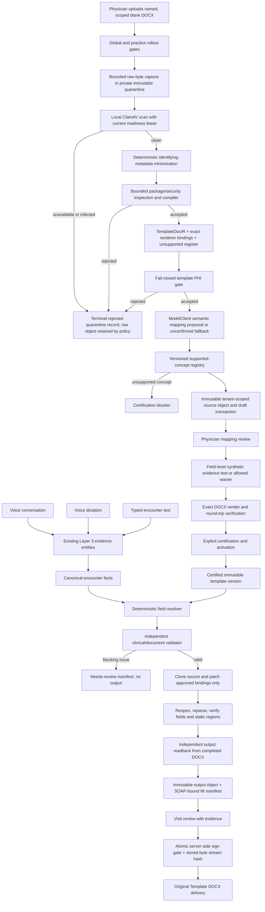

# Template Twin — Structure-Preserving DOCX v1

## Status and safety invariant

**Repository status:** deterministic WM IOV compatibility work is in progress
on the draft stacked branch `feat/template-twin-wm-iov-compatibility-v1`, based
on the still-draft safety branch `fix/template-twin-audit-gates-v1`. Neither
branch is deployed. This document is an architecture and release-gate handoff,
not deployment approval or evidence that the feature is ready for real PHI.

Template Twin is **default off at two independent server-side gates**:

- `TEMPLATE_TWIN_KILL_SWITCH` must be set to the exact value `false`; an
  absent, malformed, or truthy value keeps the feature off globally.
- `Practice.templateTwinEnabled` must be `true`; the database default is
  `false`.

Upload, compilation/certification, management, active-template selection,
generation, review, signing, and original-template export all enforce this
rollout decision on the server. Hiding the UI is not an authorization control.

Template Twin adds an exact-source Word delivery alongside the existing SOAP, coding, PDF, generic DOCX, email, and clipboard flows. It does not replace those flows.

The clinical invariant is:

> A clinical value may be rendered into the physician's DOCX only when the
> current versioned extractor can produce its certified concept, it resolves
> from retained encounter evidence or an explicitly approved practice default,
> passes independent validation, and survives output-derived exact-binding
> readback. An unresolved clinically meaningful field blocks signing. A value
> must never be manufactured from a blank, an unknown checkbox, or the nearest
> dropdown option.

No production migration, bucket provisioning, service restart, or deployment
was performed as part of this branch. Local non-production app, worker, and
migration images were built and exercised only in the disposable `meddoc-qa`
Compose project; that stack and its volumes were removed after validation.

## Architecture and data flow



The implementation is divided into these boundaries:

| Boundary                       | Primary code                                                                                       | Responsibility                                                                                                                                  |
| ------------------------------ | -------------------------------------------------------------------------------------------------- | ----------------------------------------------------------------------------------------------------------------------------------------------- |
| Untrusted DOCX                 | `apps/transcribe-md/src/lib/note-template-docx/`                                                   | ZIP/OPC/XML validation, deterministic compilation, exact rendering, independent output readback, and static-region proof                        |
| Shared contracts               | `apps/transcribe-md/src/lib/template-twin/ir.ts`                                                   | Provider-neutral IR, facts, mappings, resolutions, validation, and manifest schemas                                                             |
| Safe-alpha extraction boundary | `supported-concepts.ts`, `custom-concepts/`, `encounter-facts/`                                   | Versioned exact core allowlist plus physician-certified, template-scoped scalar extraction                                                      |
| Artifact custody               | `apps/transcribe-md/src/lib/template-twin/storage/`                                                | Tenant-scoped keys, immutable-style writes, readiness evidence, bounded stream reads, byte/hash verification, and durable object-write ledger   |
| Draft and certification        | `create-draft.ts`, `certification-lifecycle.ts`, `synthetic-test.ts`                               | Persist draft, propose/approve mappings, synthetic proof, certify, and activate                                                                 |
| Encounter filling              | `encounter-facts/`, `resolver/`, `validation/`, `fill-engine.ts`                                   | One voice/text fact path, exact field resolution, validation, rendering, and manifest persistence                                               |
| Review and signing             | `components/visit/template-twin-review*`, `review-service.ts`, `signing-gate.ts`, visit sign route | Minimal review DTO, labeled physician corrections, explicit mapping-version forks, server-side signing enforcement, and immutable sign decision |
| Delivery                       | `export/original-template-docx/route.ts`                                                           | Authenticated read of the already-rendered, hash-verified output; never regenerates at download time                                            |
| Durable safety evidence        | `audit-outbox.ts`, `worker/cleanup/template-twin-maintenance.ts`                                   | Transactional audit intent, retrying audit delivery, object-ledger reconciliation, and fail-closed maintenance configuration                    |

Version constants in v1 are:

- IR schema: `2`
- compiler: `template-docx-compiler/1.5.0`
- resolver: `template-field-resolver/1.0.0`
- renderer: `template-docx-renderer/1.5.0`
- validator: `template-field-validator/1.0.0`
- strict binding/readback: `template-docx-certified-binding/2.0.0` and
  `template-docx-readback/2.0.0`
- QA-only Office round-trip: `template-twin-office-roundtrip-qa/2.2.0`
- custom scalar extraction: `template-twin-custom-scalar-extractor/1.0.0`
- custom outcome proof: `template-twin-custom-outcome-proof/1.0.0`
- field intent: `template-twin-field-intent/1.0.0`

The 1.5 renderer accepts a persisted compiler-1.1, compiler-1.2, compiler-1.3,
or compiler-1.4 IR only when a fresh independent compile produces identical
structure/static hashes and identical parts, fields, and tables. A source whose
field status, date grammar, text-run ownership, table topology, or reachable
story set changes under 1.5 therefore fails closed and requires a new immutable
certified version.

## Immutable artifacts and tenant boundary

The source DOCX is stored before database activation under an opaque key shaped like:

```text
practices/<practice-id>/template-twin/sources/<lineage-id>/v<version>/<opaque-id>/<sha256>.docx
```

Rendered outputs use:

```text
practices/<practice-id>/template-twin/outputs/<visit-id>/<manifest-sha256>/<opaque-id>/<output-sha256>.docx
```

The application:

- never uses a user filename as an object key;
- validates the key grammar and practice prefix before every read;
- verifies provider metadata, byte length, and SHA-256 before accepting a source or output;
- reads with a hard size ceiling and hashes the stream as it is consumed;
- has no request-path Template Twin delete or overwrite method; only the
  separately gated maintenance worker can purge an unclaimed ledger object;
- stores source and output object keys only in server-side database rows;
- never sends object keys, hashes, or storage credentials to the browser review DTO;
- does not log document bytes, extracted document text, transcript text, field values, or evidence quotes in operational/audit metadata.

Every source/output write first creates a durable object-ledger intent. The
ledger records the tenant, key, digest, byte count, kind, write/claim state,
retry state, and retention boundary. The owning database transaction claims
the object only after the related source artifact or fill manifest is ready.
If the process crashes or loses a database race between object PUT and claim,
the maintenance worker reconciles the ledger idempotently. An expired
unclaimed object becomes `RETAINED` unless Operations separately enables the
exact `TEMPLATE_TWIN_ORPHAN_PURGE_APPROVED=true` boundary; maintenance alone
does not authorize deletion.

Database triggers make source-artifact rows and certification rows append-only. Certified compiler/field/mapping rows cannot be changed or deleted. Once `signedDecisionAt` is set, the fill-manifest row cannot be changed or deleted. Additional constraint triggers reject a compiled source joined to a `NoteTemplate` owner from another practice, later owner-practice reassignment, cross-practice fill lineage, output keys outside the owning visit/tenant prefix, review decisions linked to fields from another compiled version, and inconsistent waiver lineage. Compiled, template-owner, and owner-practice mutations share a transaction-scoped database lock so concurrent writes cannot each validate stale cross-table state. Those three lineage mutations are accepted only at PostgreSQL `READ COMMITTED`; snapshot-retaining `REPEATABLE READ` and `SERIALIZABLE` callers fail closed with a stable retry reason rather than validate a pre-lock snapshot. The audit-gate migration holds write-blocking table locks in one explicit transaction while it validates existing compiled rows and installs the triggers, so no concurrent mismatch can enter an installation gap.

Critical Template Twin actions enqueue PHI-safe audit intent in the same
transaction as the state change. The outbox uses stable event keys, bounded
metadata, retry/backoff, and stale-processing lease recovery before writing the
ordinary audit log. Certification, activation, deactivation, retirement,
rollback, corrections, render verification, signing, export, and safety-gate
decisions must fail rather than silently lose their required audit intent.

This is application and database immutability. Storage administrators remain a privileged threat unless the bucket is also protected with object lock/versioning and restrictive IAM; see [Dedicated bucket readiness](#dedicated-bucket-readiness-and-qa-boundary).

## Untrusted-document defenses

Every uploaded file is treated as an untrusted ZIP/OOXML package. The upload route first enforces same-origin mutation, authenticated physician ownership, `.docx` extension, allowed MIME, non-empty bytes, and a 10 MiB source limit. It reads the request stream through a hard multipart byte ceiling before calling `formData()`, so missing, false, or chunked `Content-Length` cannot bypass the limit. The exact raw bytes are captured under a private tenant-scoped quarantine key and claimed by the object ledger before any parsing, model use, compilation, or source admission. A current local ClamAV scan receipt and deterministic metadata-minimization receipt are then required. Only the minimized bytes can proceed to package inspection and compilation; the compiler still performs its own byte-level checks and does not trust the filename or browser MIME.

Default compiler limits include 512 entries, 16 MiB per expanded entry, 64 MiB total expanded content, a 100:1 maximum compression ratio, 12 MiB per parsed XML part, XML depth 128, 2,000 fields, 500 tables, and 10,000 structural nodes. Artifact reads/writes have a separate 25 MiB ceiling; source uploads remain subject to the stricter 10 MiB limit.

Rejected package classes include:

- wrong ZIP magic, missing/invalid central directory, CRC or size mismatch, overlapping local entries, or corrupt OPC declarations;
- ZIP64, multi-disk ZIP, encrypted entries, symbolic links, duplicate/case-colliding paths, unsupported compression methods, path traversal, and unsafe encoded paths;
- source, entry, total expansion, entry-count, compression-ratio, XML-depth, and structure-limit violations;
- macro-enabled DOCM content, VBA, ActiveX, custom UI, digital-signature active parts, OLE/package embeddings, `altChunk`, DDE/DDEAUTO, linked database/include fields, and attached templates;
- external or remote relationships, including `TargetMode="External"`;
- DTD/entity declarations, XML expansion/resource-limit violations, and malformed XML;
- missing or inconsistent `word/document.xml`, content types, relationships, headers, or footers.

Security-critical OOXML parsing matches namespace URI plus local name. OPC
relationship and content-type attributes are required to be unqualified; a
foreign-namespaced or duplicate-local-name `Target`, `TargetMode`, `Type`,
`Id`, or `ContentType` is rejected. Word fill structures and structural
lookalikes such as date-calendar and table-grid elements in foreign namespaces
are rejected before compilation. `mc:AlternateContent` is inventoried as a
certification blocker rather than choosing a representation silently.

Field instructions are reconstructed from both `w:fldSimple/@w:instr` and
fragmented complex `w:instrText` runs. Safe alpha uses an allowlist of harmless
instructions (`DATE`, page/section counters, time, and Word form-field
instructions); DDE/DDEAUTO, INCLUDETEXT, INCLUDEPICTURE, DATABASE, LINK, and
every other unapproved instruction fail package inspection.

Rejected raw bytes remain in the private immutable quarantine namespace with their exact object-provider identity, digest, size, tenant/uploader lineage, terminal rejection codes, and PHI-free audit intent. Request paths cannot read them back, compile them, admit them as a source, activate them, or delete them. Retention, legal hold, account-deletion treatment, and eventual privileged deletion remain Privacy/Legal and Operations decisions; until those are approved, the object ledger retains the bytes. A quarantine failure never makes an unsafe document acceptable.

Before source storage, the privacy inventory includes text nodes (including
tracked-deleted `w:delText`), every bounded non-namespace XML attribute,
document properties and metadata, relationship/content-type attributes,
header/footer/footnote/endnote parts, and image descriptions/alt text. XML
comments, CDATA, non-declaration processing instructions, custom XML, archive
or entry comments, arbitrary ZIP extra fields, and every unexpected OPC part
are rejected rather than declared scanned. The one container exception is an
exact Microsoft A220/A028 all-zero local-header growth pad; any other byte in
that payload is rejected.

Embedded media is rejected by default because unscanned pixels could preserve
patient information in every output. Safe alpha admits only a non-animated,
bounded RGB/RGBA PNG that passes byte-level chunk, CRC, dimension,
decompression, metadata, local-OCR, deterministic privacy, and shared
`modelClient` privacy checks. Image bytes are never sent to the model. An
active practice administrator must inspect the safe preview and attest that
the exact bytes are a reusable blank practice asset. Approval is scoped to the
practice and exact SHA-256; changed bytes, cross-practice use, stale scanner
evidence, or revocation blocks a new source or certification.

Approval, rejection, use, and revocation are append-only decisions with a
transactional audit-outbox event. The persisted evidence contains hashes and
scanner identities, not OCR text or image contents. The local OCR executable
must be explicitly configured through
`TEMPLATE_TWIN_LOCAL_OCR_EXECUTABLE`; missing or unhealthy local OCR is a
readiness blocker. Safe alpha supports this workflow only for PNG. JPEG, SVG,
animation, polyglots, archives, scripts, unscannable metadata, and unknown
media remain rejected. The repository contains only synthetic PNG test assets
and no real practice approval.

The preview response carries a single-use 256-bit review receipt. The browser
keeps the bearer value in memory; the database retains only its digest. The
receipt is short-lived and binds the practice, reviewing administrator, exact
asset digest, scanner/OCR/privacy evidence, and pinned global/practice rollout
generations. Approval consumes that receipt in the same transaction that
locks global rollout, practice rollout, receipt, and asset in that order,
appends the decision, and enqueues its uniquely linked audit-outbox event.
Expiry, replay, evidence drift, rollout change, cross-practice use, or a
missing/mismatched audit event fails closed.

That receipt proves server-side evidence binding and a durable attributable
decision; it cannot prove that the authorized person actually looked at every
pixel. A compromised administrator session or a privileged database operator
also remains an operational threat boundary. Fresh-session administration,
least-privilege database access, review procedure, audit monitoring, and
Privacy/Legal approval are therefore release gates rather than properties the
receipt can establish by itself.

The resulting inventory passes the deterministic PHI detector and a
fail-closed privacy scan through the shared `modelClient`. The scan sends the
privacy-relevant part text to the configured Anthropic clinical model;
therefore the appropriate vendor agreement, approved data handling, and
zero/limited-retention configuration are prerequisites. Provider failure,
uncertainty, over-limit text, suspected prompt injection, unscannable content,
or possible patient-specific content rejects the upload before admitted-source
storage, certification, or activation. The already captured raw quarantine
object remains isolated and cannot be returned through a request path; its
retention or deletion follows the separately approved object-ledger, legal-hold,
and account-deletion policy rather than an implicit discard.
An accepted immutable source also stores strict, PHI-safe scan provenance:
scanner profile, provider/model identifier, scan timestamp, scanned-part
count, and canonical hashes/counts for the exact practice approval set and
the approved assets actually used. The pre-certification synthetic proof binds
the canonical evidence hash, certification requires that exact proof-time
hash, and every later source read requires the certification binding. Missing,
malformed, legacy-null, or changed evidence blocks testing, certification,
generation, correction rendering, and signing with stable gate code
`TT_SOURCE_PROVENANCE_CURRENT_PROFILE_REQUIRED`.

## Deterministic compiler and `TemplateDocIR`

The compiler reads OOXML structure directly; it does not ask a language model to rediscover Word controls. It inventories the main document, headers, footers, relationships, styles, numbering, media, static nodes, bookmarks, and tables.

The compatibility boundary is an allowlist, not an “every DOCX” claim:

| Document structure | Admission and fail-closed boundary |
| --- | --- |
| Native scalar text | One control type, one simple paragraph, at least one Word text target, and uniform effective run formatting. Newlines require `w:text w:multiLine="true"`; otherwise a multiline resolution is rejected. Rich text, lists, drawings, mixed formatting, and multi-paragraph content block certification. |
| Dropdown / combo box | One exact finite ordered list with Word-namespaced, noncolliding `displayText`/`value` attributes. Duplicate or incomplete options block. Combo boxes operate only in exact-option mode; arbitrary free text is unsupported. |
| Checkbox | Modern `w14:checkbox` and a single deterministic legacy checkbox definition. Unknown remains a third state, affirmative and explicit denial remain distinct, and missing evidence blocks signing. |
| Date | Native `w:date` only, with a strict ISO canonical value and one bounded display pattern containing exactly one year, month, and day. Numeric formats may omit locale; English month/weekday names require `en-US`. Only Gregorian/date-time storage semantics are admitted. Legacy dates, other calendars/locales/storage modes, duplicate children, and unprofiled Word formatting tokens block. |
| Legacy form field | Exactly one immediate text, dropdown, or checkbox child; nested competing controls and `entryMacro`/`exitMacro` hooks reject the package. Legacy regular/number text rejects Word display transforms and enforces a strict 1–32,767 maximum length at render. Legacy dates and mixed definitions are unsupported. |
| Ordinary placeholder | Exact `ORDINARY_PLACEHOLDER_TOKEN_V1`: one bounded `<<...>>`, `[[...]]`, `{{...}}`, or recognized underscore token within one paragraph/story/path, with immutable span and context hashes. Other placeholders block. |
| Plain blank table cell | One unmerged, non-nested cell with one blank paragraph and at most one empty run. If the run owns formatting, output text is inserted into that same run; newlines become explicit `w:br` elements and tabs become `w:tab` elements rather than literal controls in `w:t`. Multiple runs or other mutable content block. |
| Tab-only blank cell | Exact `TAB_ONLY_BLANK_TABLE_CELL_V1`, one unmerged cell and its bounded tab-stop/property allowlist. Newlines and content tabs are rejected. |
| Tables and merges | At most 63 explicit grid columns, bounded widths, strict positive `gridSpan`, and no span outside the declared grid. A `vMerge` continuation must match the preceding restart at the same columns and span. Transitional `hMerge`, invalid/orphan `vMerge`, implicit grid-before/after, over-wide rows, and unbounded spans block. Merged blank cells are not inferred as fillable. |
| Repeating rows/sections/items | Inventoried but certification-blocked in safe alpha. No row cloning is claimed until unique Word identities and clinical row alignment are independently proven. |
| Headers and footers | Only parts reached by a schema-positioned `w:sectPr` reference with one reference per story role, exact standard relationship/content type, and the matching `w:hdr` or `w:ftr` root are compiled. Suffix lookalikes, duplicate roles, dangling references, unused story relationships, and orphan or header-shaped auxiliary parts reject the package. Supported scalar controls and exact placeholders then use the same rules as the main story. |
| Original layout | Untouched package parts and static regions are verified; supported values patch only certified targets. This technical proof does not replace the mandatory desktop Word open/save/reopen/PDF and visual approval gate. |

Detection is broader than certification support. The IR records repeating
sections/rows, rich-text controls, multi-paragraph or list-bearing text
controls, compatibility blocks, data-bound controls, fixed/merged/nested
tables, drawings, and ordinary visible placeholders, but safe alpha blocks any
of them that cannot be proven through the renderer/readback pair.

Stable `fieldId`, `tableId`, and node IDs are derived from deterministic structure and hashes, not labels alone. Duplicate labels therefore remain distinct. Each fillable field records its exact part, structural path, binding kind, ordinal, original content hash, source-control hash, table location, and native identifiers.

Unsupported or ambiguous structures are appended to the IR with a stable code,
physician-readable reason, part/path available only in advanced detail,
clinical-materiality flag, and `blocksCertification` decision. Safe-alpha
blockers include:

- all Word repeating sections/items (`REPEATING_STRUCTURE_UNSUPPORTED_SAFE_ALPHA`),
  including non-table repeats; no cloned row is certified in this phase;
- rich-text controls and plain-text controls containing multiple paragraphs or
  list structure, mixed run formatting, non-Word mutable text, or an unbounded
  multiline definition;
- ordinary placeholders and visually blank complex table cells outside an
  explicitly versioned structural profile;
- `mc:AlternateContent`, data-bound/malformed/unrecognized controls, ambiguous
  or duplicate choice options, dynamic/active fields outside the harmless
  allowlist, and imported alternative-format content; and
- unsupported date/legacy profiles, table topology outside the bounded grid and
  merge grammar, and unreachable/dangling header or footer stories; and
- structures with a missing, duplicated, moved, or otherwise unstable binding.

An ordinary placeholder is fillable only under
`ORDINARY_PLACEHOLDER_TOKEN_V1`: exactly one bounded `<<...>>`, `[[...]]`,
`{{...}}`, or recognized underscore token reconstructed within one paragraph,
with immutable token/span and surrounding-static-context hashes. It cannot
cross paragraphs, cells, stories, drawings, fields, bookmarks, revisions, or
compatibility branches. Repeated visible labels remain distinct by certified
path. Missing, moved, swapped, duplicated, partially replaced, stale, or
context-mutated tokens fail independent readback. Every other ordinary
placeholder remains a certification blocker; no unsupported item is silently
dropped or allowed to render blank under a claim that the template is fully
mapped.

The IR separately hashes:

- the immutable source package;
- the extracted structure (fields, tables, nodes, unsupported register);
- static content by part; and
- each binding's source control and original content.

### Existing `WM IOV Template.docx` compatibility evidence

The already-tracked repository fixture `WM IOV Template.docx` is read in place
by `wm-iov-existing-fixture.test.ts`; this branch does not add or copy another
real document. The current deterministic inventory reports:

| Structure                       | Aggregate finding                                                        |
| ------------------------------- | ------------------------------------------------------------------------ |
| Fillable controls               | 28 native dropdowns, 52 `TAB_ONLY_BLANK_TABLE_CELL_V1` fields, and 7 `ORDINARY_PLACEHOLDER_TOKEN_V1` fields |
| Other supported control kinds   | 0 combo boxes, 0 checkboxes, 0 date controls                             |
| Tables                          | 1 fixed table; 0 repeating tables                                        |
| Headers/footers                 | 2 header parts; 0 footer parts                                           |
| Compiler certification blockers | 0 for the 87 intended structural fields; all 7 ordinary placeholders remain `needs_confirmation` |
| Pre-storage privacy blockers    | The six exact standard glossary parts pass the narrow auxiliary profile; the embedded JPEG remains rejected |

The compiler census now recognizes all 87 intended structural fields. The seven
ordinary placeholders are deliberately not assigned clinical meaning: each
requires one physician decision and field-level synthetic evidence. The exact
six-part Word glossary profile can scan and statically bind the package's
standard glossary document, relationship, font-table, settings, styles, and
web-settings parts. The existing JPEG is still rejected, so the unchanged
fixture does **not** pass the complete upload gate. Desktop Word remains
pending.

The accepted auxiliary paths are exactly
`word/glossary/document.xml`,
`word/glossary/_rels/document.xml.rels`,
`word/glossary/fontTable.xml`, `word/glossary/settings.xml`,
`word/glossary/styles.xml`, and `word/glossary/webSettings.xml` under their
versioned namespace, content-type, relationship, resource, active-content,
privacy, and static-fingerprint profiles. This is not a wildcard allowance:
an unknown, custom, malformed, data-bound, externally related, active, or
unscannable auxiliary part still blocks storage and certification.

The embedded JPEG cannot be grandfathered into the PNG workflow and is not
automatically approved. A physician must provide a new safe template version
with the image removed or replaced by an independently reviewed synthetic/test
PNG before the ordinary upload workflow can be exercised. The existing fixture
therefore remains analysis-only and must not be described as certifiable or
usable with PHI.

## Semantic mapping and certification lifecycle

After deterministic compilation, the shared `modelClient` may propose semantic metadata for the compiler-defined field set. The structured output can propose concept, data type, polarity, temporality, laterality, unit policy, synonyms, requiredness, and blank/unknown policy. It cannot create/delete fields, move controls, alter the layout, reorder/change native options, invent practice defaults, or activate a template.

Safe alpha additionally constrains `clinicalConcept` through the versioned
registry `template-twin-soap-concepts/1.0.0`. It contains only exact concepts
that the current Layer-3 SOAP entity projection can produce and the resolver
can validate: chief concern/HPI facets, medical history, medication and allergy
components, family/social history, named tests, assessment/plan items, and the
bounded ROS/exam system lists in `supported-concepts.ts`. An ordinary
placeholder may instead use one template/version/field-scoped custom scalar
concept after the physician defines and certifies its name, description, type,
options or units, temporality, laterality, polarity/denial policy,
requiredness, blank policy, bounds, a bounded exact evidence-cue list,
evidence requirements, and positive,
negative, and ambiguity examples. The original placeholder structure remains
unchanged.

Custom extraction v1 supports only narrative text, finite number, exact
measurement/unit, ISO date, boolean, and exact single-select values. The
bounded schema is built solely from the immutable physician-certified field
specifications and is sent through the shared `modelClient`; template text is
wrapped as untrusted data and cannot add fields or instructions. Typed and
voice encounters use the same evidence-anchor contract. Every returned fact is
independently checked against exact concept identity, type, option/unit/range,
polarity, temporality, laterality, and direct evidence anchors. Not-mentioned,
denied, unknown, ambiguous, and conflict states remain distinct, and a required
unresolved custom field blocks signing. Repeating entities, arbitrary tables,
nested objects, calculations, rich text, automatic unit conversion, and
automatic clinical-policy approval remain unsupported.

Safe-alpha association is deliberately literal: one physician-approved cue and
the exact value, option, date, number, and bounded unit must occur in the same
evidence clause. Denial requires conservative cue-local negation syntax. A cue
and value split between clauses, an unrelated SOAP fact with the same number,
an unrelated negation, a unit prefix such as `mm` inside `mmHg`, or one shared
anchor assigned to multiple custom concepts becomes ambiguous and cannot
render.

The custom-field result is proof-bound rather than trusted as a free-form model
answer. Certification, fill, and signing pin the immutable field
specification, mapping/intent hash, bounded extraction-schema hash,
provider/model identity, extractor version, and acknowledged synthetic-example
outcomes. Runtime acceptance additionally requires direct patient evidence and
the certified cue, type, range, exact option/unit, polarity, temporality, and
laterality contract. Provider quality against real specialty speech remains a
separate pending evaluation and is not established by mocked synthetic tests.

If the mapping provider is unavailable, deterministic fallback mappings are saved as visibly unconfirmed. They cannot be certified without physician review.

The certification flow is:

1. Upload a blank source DOCX.
2. Compile the package through all structural/security gates and build the IR/unsupported register.
3. Run the fail-closed template PHI gate, then store the accepted immutable source.
4. Review totals, controls, tables, every field, allowed options, semantic mapping, requiredness, and unknown policy. For every ordinary placeholder, explicitly map a supported concept, designate the token static with a reason, define a bounded custom scalar specification, or leave it unresolved and certification-blocking.
5. Save physician mapping corrections. Saving invalidates any previous synthetic proof.
6. For every custom scalar field, execute every exact positive, negative, and
   ambiguity example through the shared extractor. The append-only result binds
   the current specification set, mapping/intent hashes, extraction schema,
   provider/model hashes, actual status/value/unit, and evidence/fact counts.
   The physician reviews every safe synthetic input, expected result, actual
   result, and failure code before a one-way per-example acknowledgement. A
   specification or mapping change makes the batch stale; activation requires
   every current result to pass and be acknowledged.
7. Exercise every required or clinically material field with explicitly marked
   synthetic evidence through the same Layer-3 fact/resolver/validator/renderer
   pipeline. Coverage records exact dropdown option/ordinal, checkbox polarity,
   date, number/unit, laterality, and table behavior as applicable. A single
   generic paragraph cannot certify unrelated fields. Before Layer 3 or
   persistence, synthetic input passes deterministic structured-PHI rejection
   and the conservative shared `modelClient` privacy gate. Synthetic audio uses
   the existing transcription orchestrator and is not stored by QuillMD.
8. Download and inspect the synthetic clone.
9. Explicitly acknowledge both certification statements.
10. Certify and activate only if every field mapping and placeholder intent is supported/certified, the
   field set and mapping hash are current, required/material field coverage is
   complete, every optional untested field has a current physician waiver,
   there are no blocking unsupported items, and the synthetic output has
   verified package/static/field readback.

An optional-field waiver is field-specific and records physician identity,
reason, mapping hash, and timestamp with a durable audit event. Required or
clinically material fields cannot be waived. A mapping or synthetic-test change
invalidates prior certification acknowledgements; a stale mapping hash also
invalidates waivers and coverage evidence.

Certification and activation run in a serializable transaction. Activation inactivates another active template for the same physician/encounter scope. The append-only certification records the certifier, exact structure hash, approved mapping hash, synthetic manifest, output key/hash, and timestamp.

Changing a certified mapping or placeholder intent must create a new
`NoteTemplate` lineage version. Intent decisions are append-only,
physician-attributed, hash-bound to synthetic proof/certification/fill/signing,
and durably audited. Neither a model proposal nor a visit correction can
self-certify or silently change future behavior.

## Encounter facts, resolution, and validation

Conversation recording, dictation, and typed encounter input converge after the existing Layer 3 extraction step. `projectEncounterFacts` produces the same canonical fact shape for each input mode:

- value, polarity, temporality, experiencer, and laterality;
- explicit number and unit;
- speaker and source transcript offsets when available;
- audio timestamp when available;
- evidence-anchor IDs and the supporting quote; and
- ASR/evidence quality signals.

The Template Twin resolver is deterministic over certified mappings and canonical facts. It produces `supported`, `explicitly_denied`, `not_mentioned`, `ambiguous`, `conflict`, `needs_clinician_input`, or `approved_practice_default`.

Resolution rules include exact dropdown membership and ordinal matching,
tri-state checkbox handling, independent table-cell evidence, no inferred
units, no closest-option substitution, no implicit carry-forward,
patient-experiencer checks, required laterality, and blank/approved “not
documented” behavior for unsupported evidence. Every populated value,
including an approved practice default, is schema-invalid without retained
`sourceFactIds` and evidence anchors; generated default facts are explicitly
labeled as defaults rather than encounter evidence.

Checkbox `true` requires affirmative evidence. Checkbox `false` is renderable
only for an `explicitly_denied` resolution when the physician-certified
mapping explicitly defines unchecked as false. Null, unknown, conflict, and
not-mentioned states remain unresolved; they cannot collapse to false in
native or legacy checkbox bindings. A clinically meaningful unresolved
checkbox keeps the fill `NEEDS_REVIEW` and blocks signing.

Core narrative, dropdown, multi-select, date, and repeating fields do not
render `explicitly_denied`; their current mapping contract has no exact
negative output. A physician-certified custom scalar ordinary placeholder may
render a denial only when its immutable field specification explicitly allows
denial and names the exact typed output. Resolver, validator, renderer,
independent readback, correction, and signing all enforce the same policy.

Independent validation reruns after resolution and before rendering. Blocking checks cover:

- malformed, duplicate, missing, unknown, uncertified, or type-incompatible fields/mappings/resolutions/facts;
- missing facts, missing/untraceable anchors, incomplete evidence coverage, unsupported assertions, or a populated unresolved field;
- dropdown/multi-select membership and ordinal integrity;
- checkbox polarity;
- ISO dates, finite numbers, explicit units, laterality, dates/durations, medication components, dose/route/frequency, and allergies;
- required fields, evidence conflicts, unclear evidence, and clinician-input requirements;
- table definition, row shape, aligned columns/evidence, and maximum-row overflow;
- clinically material unsupported structures.

Invalid manifests are persisted as `NEEDS_REVIEW` without an output DOCX. A valid manifest is rendered and stored as `VERIFIED`. A signed manifest is immutable.

## Exact renderer, round-trip proof, and signing

The renderer starts from bytes read and hash-verified from the immutable source. It recompiles the source and compares compiler version, source digest/size, structure, parts, fields, tables, and static hashes to the certified IR before applying any value.

It patches only approved XML spans:

- content-control display text and native dropdown/combo selection;
- checkbox state plus visible checked/unchecked glyph;
- date control value/display format;
- legacy form field state/result text;
- exact simple fixed-table-cell and tab-only-cell content;
- only the certified ordinary-placeholder token span, preserving separately
  fingerprinted surrounding static text and the original run formatting
  boundary; and
- populated control placeholder metadata (`w:showingPlcHdr` and
  placeholder-only `PlaceholderText` styling) without treating an unresolved
  control as populated.

Safe alpha does not patch multi-paragraph/list rich text or clone repeating
rows. Those structures block certification before runtime.

All other OOXML entries remain byte-identical after decompression. Modified XML parts must equal the exact source text plus the approved patches. The ZIP container itself is rebuilt deterministically enough for a valid DOCX, so the whole ZIP byte stream is not expected to match the source.

After rendering, `output-readback.ts` independently reopens the completed DOCX.
It receives source bytes, output bytes, the certified IR, and approved
resolutions—but no renderer patch objects. It reparses the package, locates
each stable binding, derives the actual content-control/legacy/table-cell
value, exact dropdown option, checkbox state/glyph, date, placeholder state,
and occurrence count from output XML, then computes output-derived value
hashes. Missing, duplicated, moved, unexpected, or value-mismatched bindings
fail closed. Package security, untouched-entry comparison, static-region
invariance, and output SHA-256 are checked separately.

Every IR field receives one proof, including blank/no-op fields. Its
disposition is `rendered`, `unresolved_blank`, `preserved_unresolved`, or
`preserved_unsupported`; omission is a verification failure. This prevents
certification and signing from disagreeing about fields the renderer skipped.

The visit review surface shows filled/review/not-mentioned/conflict counts, prioritizes critical field classes, supports an attention-only filter, surfaces deterministic long-value/repeating-row layout warnings, and reveals the resolved value, exact allowed options, reason, supporting quote, speaker, evidence anchors, and audio timestamp when present. Storage keys and provider payloads never cross the server-component DTO boundary.

A physician may explicitly correct an unsigned field. The server canonicalizes the field type, creates labeled physician-review evidence, reruns independent validation, and stores a replacement output only after exact rendering and output-derived readback. Each decision is append-only and uses optimistic manifest concurrency. “Create mapping rule” additionally forks an uncertified `NoteTemplate` version over the same immutable source/IR, resets the target mapping to `NEEDS_CONFIRMATION`, and requires a new synthetic proof and certification; it never changes the active version automatically.

Each fill manifest pins the exact physician-visible SOAP revision and canonical
SHA-256 used to resolve it. Every SOAP edit increments the SOAP version and, in
the same transaction, invalidates any unsigned Twin to `NEEDS_REVIEW`; the
prior manifest/output remain audit evidence but cannot authorize signing.
Regeneration must bind the new SOAP version/hash. The signing gate recomputes
the hash from the current SOAP and rejects a stale allergy, medication,
assessment, plan, or any other edit.

The worker and physician-correction service also lock and reread the visit in
their final serializable database transaction after rendering and immutable
object storage. They compare the exact SOAP text, version, canonical hash,
physician, and template version. If the SOAP changed during that window, a new
fill or correction is not created; an existing unsigned fill is left
`NEEDS_REVIEW`; and the newly written bytes remain an unclaimed `RETAINED`
ledger object with a durable `SOAP_BINDING_STALE` safety event. A version-only
or initial-read-only check cannot authorize the output.

The signing route independently reloads and parses the certified IR/mappings,
recomputes source/compiler/structure/static/mapping integrity, reruns the field
validator and status counts, and binds every output-derived proof to the
canonical manifest value/part/path/occurrence count. For **every** Template
Twin `READY` → `SIGNED` transition—even when the physician selected no DOCX
download destination—it reads the stored output stream, counts bytes, hashes
the bytes, and compares them with the manifest/signing claim. Missing,
truncated, modified, or replaced storage objects block signing. Only then does
the serializable transaction compare SOAP provenance and optimistically change
the exact fill claim from `VERIFIED` to `SIGNED` with the visit transition.
A concurrent correction, regeneration, artifact replacement, or stale worker
write loses closed. PHI-safe audit metadata contains codes, counts, IDs, and
versions, not clinical values.

“Original Template DOCX” is the clearly labeled primary document choice when a
Twin is active and verified, and remains an additive delivery destination
(`docx_original_template`). It is never silently signed or exported while
unresolved. The download route only serves an owned, non-deleted, signed visit
with a signed verified manifest. It reads the already-rendered object through
tenant/key/size/metadata/SHA verification and never regenerates at download
time. Existing generic DOCX/PDF/email/clipboard behavior remains available.

## HTTP surface

All responses are private/no-store. Template Twin mutation/export routes require a freshly read database user with the `DOCTOR` role, tenant/record ownership, both rollout gates, structured request validation, and same-origin checks; a stale session role cannot authorize the operation. Upload additionally requires a physician-readable name, encounter/specialty scope, and version description—there is no silent catch-all “Original Word template.”

| Method and route                                                  | Purpose                                                                                                                        |
| ----------------------------------------------------------------- | ------------------------------------------------------------------------------------------------------------------------------ |
| `POST /api/note-templates/template-twin/upload`                   | Upload, validate, PHI-scan, compile, persist draft, and return certification URL                                               |
| `PATCH /api/note-templates/template-twin/:id/mappings`            | Save the complete physician-reviewed mapping set with optimistic mapping hash                                                  |
| `POST /api/note-templates/template-twin/:id/synthetic-test`       | Resolve synthetic text, validate, render, round-trip verify, and save the current proof                                        |
| `POST /api/note-templates/template-twin/:id/synthetic-test-voice` | Transcribe ephemeral synthetic audio through the existing provider architecture, then run the same synthetic fill proof        |
| `GET /api/note-templates/template-twin/:id/test-output`           | Download an owned, currently verified synthetic output                                                                         |
| `POST /api/note-templates/template-twin/:id/certify`              | Verify current hashes/acknowledgements, append certification, and activate                                                     |
| `PATCH /api/visits/:id/template-twin/corrections`                 | Apply one physician-labeled field delta, independently revalidate/rerender, and optionally fork an uncertified mapping version |
| `POST /api/visits/:id/sign`                                       | Enforce all existing clinical gates plus the Template Twin server gate and atomic sign claim                                   |
| `GET /api/visits/:id/export/original-template-docx`               | Stream the signed, immutable, storage-verified Template Twin output                                                            |

The certification workspace is `/settings/note-format/:id/certify`. It leads
with clinical labels, field meaning, exact options, checkbox meaning,
blank/unknown behavior, defaults, unsupported items, test coverage, and output
download. OOXML part names, structural paths, hashes, and renderer bindings are
inside collapsed advanced details.

The Note Format manager provides immutable-lineage actions to create a new
version, activate, deactivate, retire, inspect history, and roll back by
activating a previously certified version without changing history. Generic
note-template lifecycle actions reject mutation of Template Twin rows through
legacy edit/delete/duplicate paths.

## Database schema and migrations

The feature uses these forward migrations:

1. `packages/db/prisma/migrations/20260715162000_template_twin_docx_v1/migration.sql`
2. `packages/db/prisma/migrations/20260715180000_template_twin_version_forks/migration.sql`
3. `packages/db/prisma/migrations/20260715203000_template_twin_audit_gates_v1/migration.sql`
4. `packages/db/prisma/migrations/20260716113000_template_twin_rollout_generations/migration.sql`
5. `packages/db/prisma/migrations/20260716190000_template_twin_placeholder_assets_v1/migration.sql`

The first migration is an atomic, timeout-bounded **expand only** migration. It
does not backfill `note_templates`, set `lineageId` non-null, or build a plain
index over the populated table. It adds:

- Template Twin audit actions and certification/detection/resolution/fill enums;
- nullable `NoteTemplate.lineageId`, `parentVersionId`, and `templateKind`, plus
  a mixed-version insert trigger;
- PHI-free durable lineage-backfill cursor/progress state;
- source artifacts, compiled versions, field definitions, semantic mappings, certifications, visit fill manifests, and review decisions;
- hash/count/state constraints, ownership/provenance foreign keys, lookup indexes, and one-fill-per-visit uniqueness;
- database triggers enforcing source, certification, certified-definition/mapping, and signed-manifest immutability.

The second migration replaces the original source/compiler unique index with a normal index. This permits a new immutable `NoteTemplate` version to reuse the same immutable source and IR when a physician explicitly creates a new mapping-rule version.

The third migration is additive and fail-closed. It adds:

- `Practice.templateTwinEnabled` with database default `false` and
  `NoteTemplate.versionDescription`;
- SOAP version/hash provenance on visit fill manifests (legacy nullable rows
  cannot sign until regenerated);
- field-level certification waivers keyed to the exact mapping hash;
- durable object-write/orphan ledger and transactional audit outbox tables;
- audit actions for waiver, deactivation, retirement, rollback, safety-gate,
  and reconciliation events; and
- compiled-source/physician-owner tenant validation, owner-reassignment,
  tenant/lineage, output-key, review-field, waiver, and immutability constraint
  triggers plus supporting indexes.

The fourth migration adds the database-backed monotonic global/practice rollout
generations and pinned/signed fill generations used for linearizable revocation.

The fifth migration is additive and performs no existing-row backfill. It adds
the immutable ordinary-placeholder intent and custom-example proof bindings,
practice-scoped static-asset evidence, single-use review receipts, append-only
asset decisions, and the decision-to-audit-outbox foreign-key contract. It
also adds database guards for intent immutability, receipt expiry/replay and
rollout generation, asset lifecycle, and exact audit-event consistency.

`prisma migrate deploy` intentionally stops at the lineage expand shape. The
versioned operator in `packages/db/scripts/template-twin-lineage-online.ts`
must then build a transition guard index concurrently, backfill bounded
primary-key batches, build final indexes concurrently, validate a non-null
proof, and take the short final contract lock. Template Twin enablement fails
closed until the durable phase is `CONTRACTED`. Full deployment, pause/resume,
lock, failure, checksum, and future Prisma-drift handling are in
`docs/runbooks/template-twin-lineage-online-migration.md`.

The third migration intentionally takes `SHARE ROW EXCLUSIVE` locks on the
compiled-version, source-artifact, note-template, and user tables for the
duration of one explicit transaction. Production rollout therefore requires a
reviewed maintenance window and lock-wait monitoring; the migration must not be
split into statementwise execution.

There is no down migration. No migration has been applied to production by
this branch. After an approved contract migration, production application
rollback uses only a reviewed current image carrying the
`template-twin-final-schema-v2` epoch in `rollback-compat-v2` mode, with the
additive schema left in place and all rollout gates off. Pre-stack app/worker
images are incompatible and prohibited. Dropping Template Twin tables, enum
values, triggers, outbox/ledger evidence, or source/output objects is
destructive and is not an approved rollback. See
`docs/runbooks/template-twin-rollback-compat-v2.md`.

## Dedicated bucket readiness and QA boundary

The application deliberately **never creates or configures the Template Twin
bucket from a request path**. `createTemplateTwinArtifactStore()` checks the
bucket and the selected readiness profile and fails closed when required
evidence is missing.

The bucket name is selected by the non-secret `TRANSCRIBE_MD_TEMPLATE_BUCKET`; when unset it defaults to:

```text
transcribe-md-template-artifacts
```

Production profile readiness requires provider verification or an explicit
operator attestation for every control: private access, encryption at rest,
TLS expectation, least-privilege runtime credentials, versioning/object lock,
lifecycle/retention, and backup/restore. A bucket that merely exists is not
ready. Attestation closes only an evidence/API gap; it does not configure the
provider.

The isolated QA compose file has a one-shot `minio-template-init` service that
creates `transcribe-md-template-artifacts-qa` separately from audio storage,
removes anonymous access, enables versioning, and creates it with MinIO object
lock capability. QA readiness does not accept a blanket “synthetic” exemption.
It requires the MinIO API to verify both:

- no anonymous/public bucket policy; and
- enabled versioning plus object-lock capability.

QA isolation also requires `TEMPLATE_TWIN_STORAGE_PROFILE=qa`, mocked providers,
a QA/test-named database, and a bucket name containing the QA marker. Controls
that this local stack cannot honestly prove require their own exact, named
exception value, `accepted-isolated-synthetic-qa-gap`:

- `TEMPLATE_TWIN_QA_STORAGE_ENCRYPTION_AT_REST_ATTESTATION`;
- `TEMPLATE_TWIN_QA_STORAGE_TLS_EXPECTATION_ATTESTATION`;
- `TEMPLATE_TWIN_QA_STORAGE_LEAST_PRIVILEGE_ATTESTATION`;
- `TEMPLATE_TWIN_QA_STORAGE_LIFECYCLE_RETENTION_ATTESTATION`; and
- `TEMPLATE_TWIN_QA_STORAGE_BACKUP_RESTORE_ATTESTATION`.

Each accepted value is reported as `qa_exception`, never `verified` or a
production attestation. A missing/malformed named exception, a public policy,
disabled versioning, or missing object-lock capability fails QA readiness.
Successful synthetic-QA readiness still returns `productionReady: false`.
Local MinIO does not prove production TLS, encryption, IAM, lifecycle, backup,
restore, or legal retention controls.

Before any approved production runtime test, Operations must:

1. Provision the bucket outside an application request path.
2. Keep it private with no anonymous policy or public URL.
3. Grant the request-serving application only the bucket-existence/stat, put,
   and get operations required by the code. If orphan purge is later approved,
   review a separately scoped worker identity for delete access to this
   dedicated bucket; do not give request paths delete authority.
4. Enable object lock at bucket creation when supported, or document the approved versioning/IAM alternative. Application UUID+digest keys and no-delete code reduce accidental overwrite risk but do not constrain a storage administrator.
5. Enable encryption at rest consistent with the QuillMD storage standard.
6. Include the bucket in encrypted backup/off-site-copy procedures and perform a documented synthetic restore test.
7. Define source/output retention with Privacy/Legal and Clinical Records. Do not attach a generic lifecycle deletion rule until signed-record retention is approved.
8. Add capacity, read-integrity, and failed-write alerts with an Operations owner.
9. Verify that logs/metrics record only safe error codes, counts, size, and hashes—not keys, filenames, document text, or field values.

The worker has an opt-in maintenance job for outbox delivery and object-ledger
reconciliation. `TEMPLATE_TWIN_MAINTENANCE_ENABLED=true` requires a bounded
`TEMPLATE_TWIN_ORPHAN_RETENTION_DAYS` (1–365). It can recover an object whose
PUT succeeded before ledger state was advanced, retry transient stat/delivery
failures, and retain an expired orphan. Deletion remains independently off
unless `TEMPLATE_TWIN_ORPHAN_PURGE_APPROVED=true` is present at the destructive
boundary. Enabling purge requires an approved retention/legal-hold decision;
the branch does not invent one.

## Deployment order and operational acceptance

No deploy is authorized by this document. When separately approved, use an isolated QA environment and synthetic templates first.

Required order:

1. Record app/worker image digests, database migration status, and backup/restore evidence.
2. Provision and verify the private bucket and least-privilege runtime policy.
3. Confirm Anthropic/vendor agreement and privacy controls for source PHI scanning and mapping proposals.
4. Apply all Template Twin Prisma migrations through the existing migration deployment path.
5. Deploy compatible TranscribeMD app and worker images together; the app owns upload/review/sign/export, while the worker owns encounter filling.
6. Verify application and worker health without real PHI.
7. Run one synthetic upload → mapping review → synthetic output → certification → typed visit → review → sign → original DOCX flow.
8. Run a synthetic voice visit through the same certified template.
9. Verify durable outbox delivery, object-ledger reconciliation, and
   object/database hashes without printing payloads.
10. Keep `Practice.templateTwinEnabled=false` for every practice until its
    named clinical/operations approval; use the global kill switch for an
    immediate all-practice stop.
11. Obtain Engineering, Clinical Safety, Privacy/Legal, and Operations
    approval before any real-PHI pilot.

## Versioning and rollback

- Source artifacts and certified versions are immutable. A mapping/layout change creates a new lineage version; it never alters past visits.
- Each fill manifest pins template, compiler, resolver/model, renderer,
  fact-set hash, manifest hash, output hash, validation result, and exact SOAP
  version/hash.
- Worker retries atomically pin the active template ID/version before provider or object-storage I/O, then reuse that exact pin even after a newer lineage version becomes active; missing or inconsistent pins fail closed.
- A retry with the same manifest is idempotent. A changed unsigned result increments the database optimistic `manifestVersion` and creates a new output key. Reviewed or signed manifests reject worker replacement, and an unrelated visit review reason is never cleared by Template Twin.
- Existing generic note formats and exports are not removed.
- Product rollback for new visits is to activate a previously certified Twin
  version or deactivate the Twin and return to the approved structured
  template; historical Twin fills/outputs remain retained. They remain readable
  in standard mode under the normal signing/export gates, but Template
  Twin-specific review/certification UI and original-layout DOCX download are
  intentionally unavailable during `rollback-compat-v2`.
- Immediate rollout rollback is `TEMPLATE_TWIN_KILL_SWITCH` absent/truthy or
  `Practice.templateTwinEnabled=false`; after contract, deployment rollback
  swaps app and worker together only to an independently accepted current-code
  `rollback-compat-v2` image pair and leaves additive database changes in
  place. It never restores a pre-stack image.
  The practice flag is rechecked in the final acknowledgement/signing database
  claim so a concurrent disable wins closed. The process environment kill
  switch stops newly evaluated requests; changing it by app rollout does not
  purport to drain work already executing on an older process, so Operations
  should also disable the practice flag before or with a global stop.
- If migrations themselves cause an unrecoverable database incident, use the established point-in-time/verified-backup recovery procedure. Do not improvise table drops on production.
- Before rollout, record exact previous app/worker image digests as disaster
  evidence, but do not treat a pre-stack digest as eligible after contract.
  Build and independently verify a final-schema-compatible bridge image pair
  before migration; prove it through the checked runtime-swap guard.

## Active TranscribeMD verification commands

Run from the repository root unless a command says otherwise. Bare root `npm run lint`, `npm run build`, and `npm run test:unit` target the legacy `meddoc-pro` workspace, not TranscribeMD, and are not the acceptance commands for this feature.

| Check                  | Active command                                                    | Notes                                                                           |
| ---------------------- | ----------------------------------------------------------------- | ------------------------------------------------------------------------------- |
| Prisma format          | `npx prisma format --schema packages/db/prisma/schema.prisma`     | Formatting only; review the resulting diff                                      |
| Prisma validation      | `npx prisma validate --schema packages/db/prisma/schema.prisma`   | Read-only schema validation                                                     |
| Generate client        | `npm run db:generate`                                             | Alias for `npm run generate -w @meddoc/db`                                      |
| Migration status       | `npm run db:migrate:status`                                       | Read-only status; do not use production credentials during local validation     |
| Targeted unit tests    | `npm run test:unit -w transcribe-md -- <app-relative-test-paths>` | Vitest runs from `apps/transcribe-md`; use `src/...` paths                      |
| Full active unit suite | `npm run test:unit -w transcribe-md`                              | Includes TranscribeMD and `packages/*/src` tests via the app Vitest config      |
| Typecheck              | `npx tsc -p apps/transcribe-md/tsconfig.json --noEmit`            | No package script exists; this is the active app config                         |
| Lint                   | `npm run lint -w transcribe-md`                                   | Covers app and worker source under the workspace                                |
| Production build       | `npm run build -w transcribe-md`                                  | Next.js 16 build; do not run against the live checkout during a read-only audit |
| TranscribeMD E2E       | `npm run test:e2e -w transcribe-md`                               | Playwright; isolated QA/test services and synthetic data only                   |
| Root E2E alias         | `npm run test:e2e:transcribe-md`                                  | Equivalent workspace alias                                                      |

CI evidence lives in:

- `.github/workflows/test.yml` — `npm run test:unit -w transcribe-md`;
- `.github/workflows/e2e.yml` — isolated TranscribeMD app/worker/QA stack and Playwright;
- `.github/workflows/a11y.yml` — TranscribeMD production build and accessibility run.

Migration deployment is `npm run db:migrate:deploy`, but it is an operational write and must run only in an explicitly approved deployment window. It is not a developer verification command.

### Synthetic test plan and result record

Only synthetic, deterministic fixtures are permitted. No provider, email, billing, storage-deletion, or production-service call belongs in the unit suite.

Required fixture coverage:

- native dropdowns, combo boxes, text/date controls, native and legacy checkboxes;
- legacy fields, fixed tables, repeating/nested/merged structure blockers,
  headers/footers, duplicate labels, long values, ordinary placeholders, rich
  text, and unsupported controls;
- corrupt ZIP/OPC/XML, wrong magic, path traversal, duplicate paths,
  symlink/encryption/ZIP64, namespace-shadowed relationships/content types,
  fragmented field instructions, malicious relationships, DTD/entity input,
  active content, OLE, and decompression/XML/resource limits;
- tracked-deleted PHI, document metadata, custom XML, image descriptions, and
  non-allowlisted media rejection before storage;
- semantic mapping with mocked `modelClient` output and fallback behavior;
- exact-option, tri-state checkbox, denial policy, unit, laterality,
  medication/allergy, table, evidence, supported-concept, and
  unsupported-element validation;
- renderer/readback independence, placeholder cleanup, static-region
  invariance, output-derived field-value hashes/occurrences, and fail-closed
  post-render mutation paths;
- fresh-role physician/practice authorization, lifecycle immutability, mapping-hash conflicts, certified-field overlays, certification prerequisites, signing claim races, pre-sign artifact verification, and export integrity;
- synthetic-marker/privacy-gate rejection before Layer 3 or persistence;
- stale SOAP and corrupted/missing stored-object sign blocks, account deletion
  with retained Twin data, feature-off routes, and direct-database cross-tenant
  insertion rejection;
- stateful upload-to-certification integration, route-level
  voice-to-filled-original E2E, typed/voice equivalence, correction and SOAP
  invalidation/regeneration, orphan reconciliation, retry-pin/reviewed-manifest
  races, and regression of current note-format and generic exports.

Complete this table at merge handoff; do not replace missing evidence with assumptions:

| Gate                                        | Command/evidence                                                             | Result                                                                                                             | UTC        | Commit/run link                    |
| ------------------------------------------- | ---------------------------------------------------------------------------- | ------------------------------------------------------------------------------------------------------------------ | ---------- | ---------------------------------- |
| Prisma format/validate/generate             | Commands above                                                               | `PASS`                                                                                                                  | 2026-07-16 | Local compatibility change set        |
| Full Template Twin suite                    | Consolidated feature-path invocation, including the tracked WM fixture       | `PASS — 77 files / 920 tests`                                                                                           | 2026-07-16 | Synthetic/local only                  |
| Full TranscribeMD unit suite                | `npm run test:unit -w transcribe-md`                                         | `PASS — 219 files / 2,766 tests`                                                                                        | 2026-07-16 | Synthetic/local only                  |
| Type generation/typecheck                   | `next typegen` then active `tsc --noEmit` command                            | `TYPECHECK PASS; type generation pending final-SHA rerun`                                                              | 2026-07-16 | Local compatibility change set        |
| Focused/full lint                           | Changed-path files / full active command                                     | `FOCUSED PASS; full repository lint pending final-SHA result and baseline comparison`                                  | 2026-07-16 | Do not infer a full-lint pass          |
| Production build                            | Clean Docker app/worker/migrator image builds                                | `PENDING FINAL-SHA RERUN`                                                                                               | —          | Disposable local images only          |
| Migration tests                             | Fresh QA PostgreSQL plus interrupted/resumed one-million-row upgrade harness | `PASS — all 72 migrations; 1,000,000 requested / 1,000,226 processed; retry/idempotency/lock-contention proof passed` | 2026-07-16 | Disposable QA only                    |
| Isolated infrastructure-backed QA E2E       | `playwright test --project=template-twin`                                    | `PENDING FINAL-SHA RERUN`                                                                                               | —          | QA stack must be disposable            |
| Browser safety/accessibility                | Chromium, PHI reject, Rx safety, and axe projects                            | `PENDING FINAL-SHA RERUN`                                                                                               | —          | Synthetic/local only                  |
| Open XML and LibreOffice gate               | SDK 3.5.1 plus pinned LibreOffice 25.8.7.3                                   | `PENDING ORDINARY-PLACEHOLDER CORPUS RERUN`                                                                             | —          | Pre-delivery and QA-only proofs differ |
| Desktop Microsoft Word                      | Returned no-network Windows QA bundle                                        | `PENDING`                                                                                                               | —          | Mandatory release gate                |
| Dependency/secret gates                     | npm high/critical audit and TruffleHog filesystem scan                       | `PENDING FINAL-DIFF RERUN`                                                                                              | —          | Never infer from an earlier SHA        |
| Live provider quality                       | Approved synthetic specialty evaluation with provider provenance             | `PENDING`                                                                                                               | —          | Mocked tests are not provider evidence |
| Backup/restore and production bucket policy | Operations evidence                                                          | `PENDING`                                                                                                               | —          | Production-readiness prerequisite     |
| Clinical/privacy approval                   | Named Clinical Safety and Privacy/Legal approval records                     | `PENDING`                                                                                                               | —          | Real-PHI prerequisite                 |

## Current limitations and v1 non-goals

### Exact WM IOV compatibility slice

`TAB_ONLY_BLANK_TABLE_CELL_V1` is the only additional unbound table-cell
profile admitted by this compatibility branch. It is not generic complex-table
support. The compiler requires one unmerged, non-nested target cell with one
blank paragraph. That paragraph contains only an approved set of ordinary
paragraph/run properties and exactly one left tab-stop definition under
`w:pPr/w:tabs/w:tab`; it contains no mutable run or visible text. A physician
must still confirm the inferred label, clinical mapping, blank policy, and
synthetic coverage before certification.

The renderer preserves the complete table, cell, paragraph properties, and tab
stop and appends one plain `w:r/w:t` value at the certified cell path. Strict
readback derives the value from that completed run, fingerprints the profile,
and inventories every profiled cell across the package. A moved, swapped,
duplicated, missing, merged, or property-altered cell fails
`template-docx-readback/2.0.0`; the profile proof is required again by
certification and signing. Newlines and content tabs are rejected, and the
existing 32,767-character limit continues to produce an overflow review gate.
The completed-byte fingerprint binds the exact cell/paragraph attributes and
the immutable `tcPr`/`pPr` descriptors. The renderer-owned run must have no
attributes or formatting children, and its one text node may carry only the
conditionally required `xml:space="preserve"`. Tracked-deletion attributes,
raw property text, added run attributes, and unnecessary text-preservation
metadata all fail strict readback.

The unchanged WM IOV fixture still deterministically compiles 52 cells under
this profile. `ORDINARY_PLACEHOLDER_TOKEN_V1` separately recognizes its seven
visible ordinary tokens as physician-confirmation-required fields; it does not
guess their clinical meaning. The exact six standard glossary parts pass the
narrow auxiliary inspection profile. The embedded JPEG remains rejected, so
the complete unchanged document still cannot upload or certify. Rich text,
repeating sections, unprofiled placeholders, unprofiled auxiliary content,
unapproved/unsupported media, and every other complex-cell signature remain
outside this slice.

Current implementation limitations that must remain visible:

- Word has no server-side layout engine here. The renderer enforces character
  limits plus XML/package integrity and can flag long replacements, but it
  cannot prove page-level overflow, pagination, font substitution, printer
  behavior, or whether desktop Word shows an open-repair dialog. The pinned
  LibreOffice synthetic round-trip passed for this profile; human desktop Word
  visual/open-repair QA remains a release gate.
- The ZIP container is rebuilt, so ZIP-level timestamps/compression/order may differ. The guarantee is approved XML patches plus byte-identical decompressed untouched entries and static-content invariance, not a byte-identical whole file.
- All repeating sections, multi-paragraph/list rich text, data-bound controls,
  ordinary placeholders outside `ORDINARY_PLACEHOLDER_TOKEN_V1`, unprofiled complex table cells,
  `mc:AlternateContent`, active/unapproved fields, and ambiguous structures are
  certification-blocked in safe alpha.
- Template-aware extraction is intentionally limited to physician-certified
  scalar specifications attached to deterministic ordinary placeholders. It
  does not support repeating entities, arbitrary structures, calculated
  conclusions, or general template-driven instructions. Those require a later
  separately reviewed extraction-agent phase.
- Object-ledger reconciliation and audit delivery exist but are opt-in and do
  not replace an operations dashboard, alert owner, approved retention policy,
  or documented restore test. Orphan purge remains separately off.
- Accounts without Twin records keep the existing tested deletion path.
  Accounts with retained Twin source/certification/waiver/template/fill,
  object-ledger, outbox, or delivered-audit records receive deterministic HTTP
  409 with no partial database or bucket deletion.
  Privacy/Legal must decide anonymization, retention, and legal-hold policy
  before that path can change.
- Template Twin corrections intentionally do not clear a generic visit-level `needsReview` reason because other safety lanes may own it; clearing requires an explicit source-aware review-state model in a later change.
- The PHI gate cannot establish legal compliance by itself. Vendor agreements, policy, retention, access controls, backups/restores, incident response, and clinical approval remain separate requirements.
- Evidence anchors prove traceability to retained encounter evidence; they do not prove that ASR/model extraction is clinically correct. The physician still reviews and signs.

Explicit v1 non-goals:

- flattened/scanned PDF or PDF AcroForm filling;
- XLSX templates;
- marketing redesign, billing, provider migration, or production deployment;
- automatic learning from corrections without explicit physician approval;
- direct EHR integration; and
- replacing the existing generic DOCX/PDF/export or model-provider architecture.

## Production acceptance checklist

Production remains blocked until all of the following have evidence:

- all Template Twin migrations reviewed and applied in isolated QA;
- private bucket, IAM, encryption, immutability control, retention, backup, restore, and alert ownership approved;
- all test-result placeholders above completed with passing or explicitly dispositioned results;
- correction/rerender/new-version workflow tested in isolated QA with synthetic values;
- the infrastructure-backed upload → certification → typed/voice → SOAP edit
  invalidation → regeneration → correction → signing → stored-byte verification
  → download test passes against actual QA Postgres, Redis/worker, and MinIO;
- synthetic typed and voice end-to-end outputs visually compared with their original DOCX;
- no critical unresolved field can sign through direct API calls or races;
- existing custom-template and generic export regressions pass;
- Anthropic and storage vendor agreements/data handling approved by Privacy/Legal;
- a clinical owner approves review wording, critical-field policy, and synthetic cases;
- the global switch and every practice remain default off until a documented
  rollout/kill-switch exercise succeeds;
- prior image digests and rollback procedure recorded; and
- explicit founder/operations authorization for the production deployment window.
